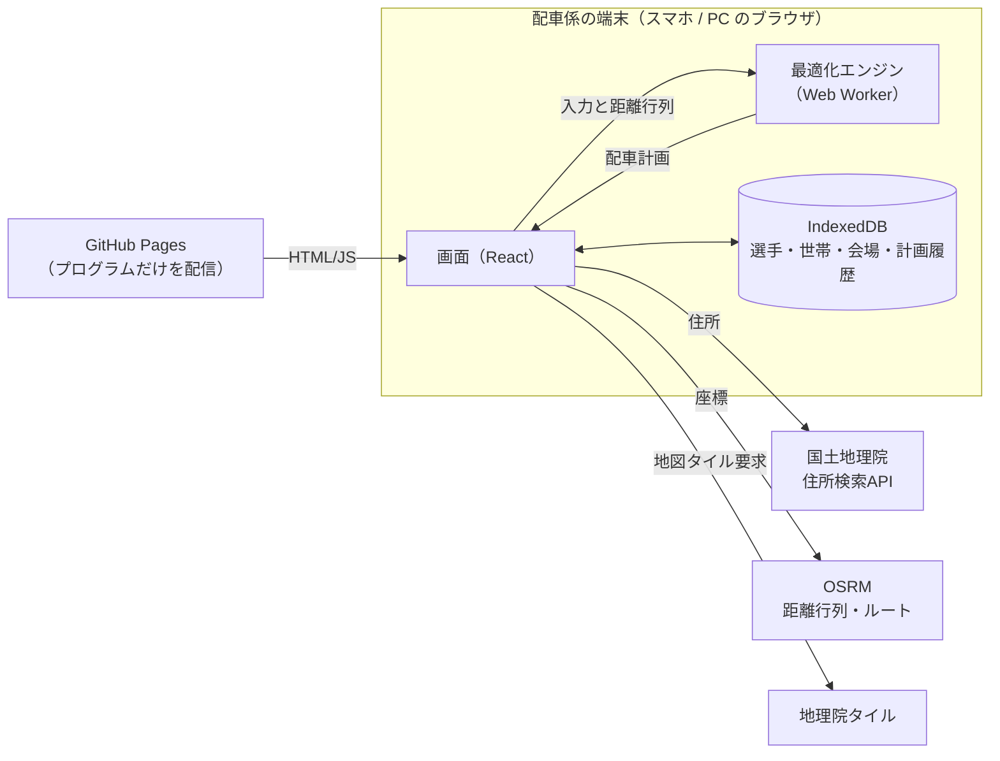
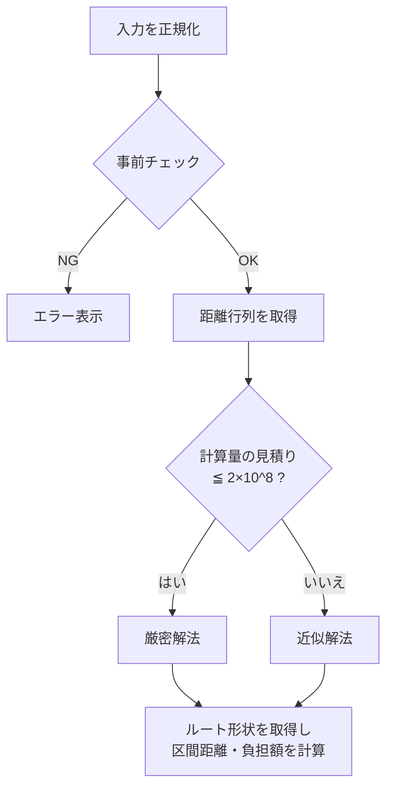

# 設計書：配車最適化アプリ

作成者：26W1004岩﨑悠志　／　作成日：2026/10/22
元にした仕様書：[26W1004_spec.md](26W1004_spec.md)

---

## 0. 仕様の解釈と確定事項

仕様書から読み取りにくかった点は、次のように決めた。

| # | 論点 | 決定 |
|---|---|---|
| D1 | アプリの構成 | 静的Webアプリ（PWA）とし、データは配車係の端末だけに保存する（理由は 2.1） |
| D2 | 「その子が乗った区間の往復移動距離」 | 乗車地点から会場までの**実際の走行ルート上の距離 × 2**。他の家への寄り道の分も含む |
| D3 | 同乗者の費用負担額 | 仮ルール「負担額 ＝ 区間往復距離(km) × 単価(円/km)」で計算する。単価は画面で設定できるようにし、計算式は 1 か所の関数にまとめて後で差し替えられるようにする |
| D4 | 車を出せる家庭が駐車可能台数より少ない場合 | 駐車可能台数を**上限**として扱い、出せる車をすべて使う。定員が足りなければエラーにする |
| D5 | 車を出せる家庭が駐車可能台数より多い場合 | 仕様どおり、ちょうど駐車可能台数の車を使う。どの家庭が出すかは最適化で決める |
| D6 | 兄弟の扱い | 「世帯」を導入する。同じ世帯の子は同じ車に乗せ、乗車地点も 1 か所とする |
| D7 | 車出しと乗車可能人数の入力単位 | 世帯単位で入力する（車は世帯で 1 台）。参加可否は選手ごとに入力する |
| D8 | 運転する家庭の子 | 自分の家の車に乗る。乗車可能人数には数えない（仕様の定義どおり） |
| D9 | 道路距離が取れないとき | 直線距離では代用せず、エラーにする（仕様「直線距離ではなく」による） |
| D10 | 子が参加しない世帯の車出し | 運転手に選べない。車出し可否の入力があっても、その試合に参加する子が 1 人もいない世帯は車を出せる世帯から外す |

---

## 1. システム全体像



- サーバーに個人情報は置かない。配信するのはプログラムだけである。
- 最適化はブラウザの中（Web Worker）で動かす。計算中も画面は固まらない。
- 外部 API は、住所から座標への変換、道路距離、地図の 3 つだけを使う。いずれも無料で、API キーもいらない。

---

## 2. 技術選定

### 2.1 構成の比較と選定理由

| 案 | スマホ・PC | 個人情報 | 無料 | 判定 |
|---|---|---|---|---|
| **A. 静的Webアプリ＋端末内保存** | ブラウザで動く。PWA としてホーム画面に追加できる | 端末の外に保存しない | GitHub Pages は無料 | **採用** |
| B. Firebase（認証＋Firestore） | 端末間で同期できる | クラウドに保存するため、アクセス制御ルールの設計と運用が必要 | 無料枠で収まる | 不採用 |
| C. Python Streamlit をクラウド公開 | ブラウザで動く | 公開サーバー上に保存する必要があり、無料枠ではデータが消えやすい | 無料 | 不採用 |

A を選んだ理由：

- 「個人情報を Web 上に公開しない」を、仕組みとして最も確実に満たせる。データがサーバーに存在しない。
- 配車係は 1 人なので、端末間の同期は必須ではない。機種変更や PC との受け渡しは、JSON バックアップの書き出しと読み込みで対応する。
- 最適化は 30 世帯程度なら、ブラウザ内の JavaScript で 1 分以内に解ける（5 章）。

### 2.2 使用技術

| 用途 | 採用技術 | 備考 |
|---|---|---|
| 言語 / ビルド | TypeScript 5 / Vite 5 | |
| 画面 | React 18 | スマホ幅を基準にしたレスポンシブ表示 |
| PWA | vite-plugin-pwa | ホーム画面に追加でき、オフラインでもマスタを閲覧できる |
| 端末内保存 | IndexedDB（ラッパーに Dexie.js 4） | |
| 地図 | Leaflet 1.9 ＋ 地理院タイル（標準地図） | 出典の表示が必要 |
| ジオコーディング | 国土地理院 住所検索 API（`msearch.gsi.go.jp/address-search/AddressSearch`） | 世帯登録時に 1 回だけ呼び、結果の座標を保存する |
| 道路距離・ルート | OSRM 公開サーバー（`router.project-osrm.org`） `table` API と `route` API | 片道・自動車。渋滞は考慮しない |
| テスト | Vitest | 最適化は外部 API を使わずにテストする |
| 配信 | GitHub Pages（GitHub Actions でビルドして配置） | リポジトリに個人情報を含めない |

---

## 3. データ設計

すべて端末の IndexedDB に保存する。ID は UUID とする。

### 3.1 マスタ（固定データ）

**世帯 `households`**

| 項目 | 型 | 説明 |
|---|---|---|
| id | string | 世帯ID |
| label | string | 表示名（例：「山田家」） |
| address | string | 自宅住所 |
| lat, lng | number | 住所から求めた座標。地図で手動修正できる |
| geocodedAt | string | 座標を求めた日時 |

**選手 `players`**

| 項目 | 型 | 説明 |
|---|---|---|
| id | string | 選手ID |
| name | string | 名前 |
| householdId | string | 所属する世帯。兄弟は同じ世帯にする |
| active | boolean | 在籍中か（退団した選手を一覧から外す） |

**会場 `venues`**

| 項目 | 型 | 説明 |
|---|---|---|
| id | string | 会場ID |
| name | string | 会場名 |
| address, lat, lng | | 世帯と同じ |
| defaultParking | number | 駐車可能台数の初期値 |

### 3.2 試合ごとのデータ（都度変動）

**計画入力 `planInputs`**

| 項目 | 型 | 説明 |
|---|---|---|
| id | string | |
| matchDate | string | 試合日 |
| venueId | string | 会場 |
| parking | number | 駐車可能台数（この試合での値） |
| attendance | `{ playerId: boolean }` | 参加可否 |
| drivers | `{ householdId: number }` | 車を出せる世帯と、その乗車可能人数（運転手と自分の子を除く）。参加する子がいない世帯は計算時に除外する（D10） |
| unitPriceYenPerKm | number | 費用負担の単価（初期値 17 円/km。ガソリン 170 円/L、燃費 10 km/L を想定） |

**計画結果 `planResults`**

| 項目 | 型 | 説明 |
|---|---|---|
| inputId | string | 元の計画入力 |
| inputSnapshot | object | 計算に使った入力一式（座標を含む）のコピー |
| distanceMatrix | number[][] | 計算に使った道路距離行列（メートル単位の整数） |
| cars | Car[] | 車ごとの結果（下記） |
| riders | Rider[] | 子どもごとの区間距離と負担額 |
| totalDistanceM | number | 全車の走行距離の合計 |
| method | `"exact"` \| `"heuristic"` | 厳密解か近似解か |
| computeMs | number | 計算時間 |
| createdAt | string | |

```ts
type Car = {
  driverHouseholdId: string;
  stops: string[];          // 立ち寄る世帯IDの順番（運転手宅と会場は含めない）
  capacity: number;
  load: number;             // 乗せる子の人数（自分の子は除く）
  distanceM: number;        // 運転手宅から会場までの片道距離
  geometry: [number, number][]; // 地図に描く経路
};

type Rider = {
  playerId: string;
  driverHouseholdId: string;
  isOwnCar: boolean;        // 自分の家の車に乗るか
  sectionDistanceM: number; // 乗車地点から会場までの走行距離（片道）
  roundTripDistanceM: number; // 上の 2 倍
  costYen: number;          // 自分の家の車なら 0
};
```

計算に使った入力と距離行列を結果と一緒に保存しておく。こうすると、後で地図データが更新されて道路距離が変わっても、同じ計画を再現し、検証できる。

### 3.3 バックアップ

- 全データを JSON ファイル 1 つに書き出し、読み込みもできるようにする。
- 選手と世帯は CSV でも一括登録できるようにする（UTF-8 と Shift_JIS の両方に対応）。
- iPhone の Safari は、サイトを 7 日間使わないと保存データを消すことがある。対策として、ホーム画面に追加して使うよう画面で案内し、定期的なバックアップも促す。

---

## 4. 画面設計

下部のタブで切り替える 4 画面構成とする。スマホの縦画面を基準にし、PC では横に広げて表示する。

| 画面 | 主な機能 | 対応する仕様 |
|---|---|---|
| ① 配車計画 | 試合日・会場・駐車可能台数を入力する → 選手一覧で参加可否をチェックする → 世帯ごとに車出し可否と乗車可能人数を入力する → 「計画を作成」 | 4章 入力系 |
| ② 結果 | 地図に車ごとの色でルートを表示する。車ごとの立ち寄り順・距離、子どもごとの区間往復距離と負担額を表で示す。共有用のテキストもコピーできる | 4章 表示系 |
| ③ マスタ | 世帯・選手・会場の登録、編集、表示。住所を入れると座標を求め、地図上でピンを確認、修正できる。CSV 取り込みも行う | 4章 名前・住所の登録 |
| ④ 設定 | 費用単価、バックアップの書き出しと読み込み、全データ削除、外部サービスの出典表示 | 3.3、6章 |

### 4.1 配車計画画面の入力の流れ

```
[試合日] [会場 ▼] [駐車可能台数 ( 4 )]  ← 会場の初期値が入る
─────────────────────────────
山田家   □車を出す  乗車可能 [ 3 ]人
   ☑ 山田 太郎
   ☑ 山田 次郎
佐藤家   ☑車を出す  乗車可能 [ 4 ]人
   ☑ 佐藤 花子
...
─────────────────────────────
参加 18人 / 車出し可 5台 / 空席合計 16席
              [ 計画を作成 ]
```

- 世帯の子が 1 人も参加にチェックされていないときは、「車を出す」を選べなくする（D10）。
- 入力しながら、参加人数と空席の合計を常に表示する。明らかに足りないときは、ボタンを押す前に警告する。
- 前回の試合の入力内容を複製できるようにする（毎回すべて入力し直さずに済むように）。

### 4.2 結果画面の表示項目

- 合計走行距離（片道）、使った台数、計算方法（厳密解か近似解か）、計算時間
- 車ごと：運転する世帯、立ち寄り順（運転手宅 → 〇〇家 → △△家 → 会場）、片道距離、乗車人数と定員
- 子どもごと：乗る車、区間距離（片道）、往復距離、負担額
- 地図：車ごとに色を分けた経路と、自宅（番号つき）と会場のピン

---

## 5. 最適化エンジン設計

### 5.1 問題の定義

**集合と記号**

- 世帯 h：その試合に参加する子が 1 人以上いる世帯
- k_h：世帯 h から参加する子の人数
- D：車を出せる世帯のうち、参加する子がいる世帯の集合（D10）。各世帯の乗車可能人数を cap_h とする
- K：使う台数。K = min(駐車可能台数, |D|)
- d(i, j)：地点 i から j への道路距離（片道、メートル）

**決めること**

1. D の中から、車を出す K 世帯を選ぶ
2. 車を出さない世帯それぞれを、どの車に乗せるか
3. 各車が、どの順番で家を回るか

**目的**

全車の走行距離の合計を最小にする。1 台の走行距離は「運転手宅 → 立ち寄り先 → 会場」の片道距離である。

**制約**

- 子が参加する世帯は、すべてちょうど 1 台に割り当てる
- 各車の乗車人数（自分の子を除く）は、乗車可能人数以下にする
- 同じ世帯の子は同じ車に乗せる
- 車を出す世帯の子は自分の家の車に乗る
- 選ばれなかった車出し可能世帯は、乗せてもらう側になる
- 参加する子がいない世帯は、車を出す側にも乗せてもらう側にも含めない

これは、「どの車を使うか」の選択がついた、容量制約つきの複数巡回セールスマン問題（終点はすべて会場）である。

### 5.2 解き方：規模で 2 つを切り替える



**① 厳密解法（小規模：乗せてもらう側がおおむね 10 世帯以下のとき）**

1. 車を出す世帯の組み合わせ C(|D|, K) 通りをすべて試す。
2. それぞれについて、車 c と立ち寄り先の集合 S の組ごとに、最短の回り方を Held-Karp 法（動的計画法）で求める。定員を超える S は除外する。
3. 立ち寄り先の集合を K 台に分ける最適な分け方を、部分集合 DP で求める。
4. すべての組み合わせの中で、合計距離が最小のものを採用する。

計算量はおよそ C(|D|,K) × K × (2^n × n² + 3^n) である（n は乗せてもらう側の世帯数）。この見積りが 2×10^8 以下なら厳密解法を使う。

**② 近似解法（大規模のとき）**

1. **初期解**：車を出す世帯の初期の選び方を、決まった規則で複数つくる（会場から遠い順、乗車可能人数が多い順など）。加えて、シード付き乱数で 50 通りつくる。
2. **割当**：各初期解について、乗せてもらう世帯を「後回しにすると距離が一番増える世帯から」順に、増加距離が最小の位置へ挿入する（regret 挿入法）。
3. **局所探索**：次の操作で改善がなくなるまで繰り返す。
   - 世帯を別の車へ移す
   - 2 台の間で世帯を入れ替える
   - 1 台の中で回る順番を変える（2-opt、Or-opt）
   - 車を出す世帯を、出していない車出し可能世帯と入れ替える
4. 全ての初期解の結果から、合計距離が最小のものを採用する。

目安の規模（30 世帯、車 8 台）なら、スマホでも数秒から十数秒で終わる想定である。実装後に計測して、試行回数を調整する。

### 5.3 再現性（同じ条件なら同じ結果）の担保

仕様の受入基準を満たすため、次のすべてを守る。

| 対策 | 内容 |
|---|---|
| 入力の正規化 | 世帯・選手を ID 順に並べてから計算する。入力した順番に結果が左右されない |
| 距離は整数 | 道路距離はメートル単位の整数に丸める。小数の誤差で比較結果が変わらない |
| 乱数シードの固定 | シードは入力内容から計算したハッシュ値とする。同じ入力なら同じ乱数列になる |
| 回数で止める | 近似解法は「時間」ではなく「試行回数」と「改善がなくなったら終了」で止める。端末の速さで結果が変わらない |
| 同点の扱い | 合計距離が同じ解が複数あるときは、「車出し世帯 ID の並び → 各車の立ち寄り順」の辞書順で一番小さいものを選ぶ |
| 距離行列の保存 | 計算に使った距離行列を結果と一緒に保存する（3.2） |

**安全装置**：万一 55 秒を超えた場合は、その時点の最良解を返す。その際は「時間打ち切りのため再現性が保証されません」と表示する。通常の規模では発生しない想定である。

### 5.4 区間距離と負担額の計算

車 c のルートを「運転手宅 → s1 → s2 → … → sm → 会場」とする。

- 世帯 si の子の区間距離（片道）＝ d(si, si+1) + … + d(sm, 会場)
- 往復距離 ＝ 区間距離 × 2
- 負担額 ＝ 往復距離(km) × 単価(円/km)。1 円未満は四捨五入する
- 運転手の子は、区間距離 ＝ 車の片道距離、負担額 ＝ 0
- 兄弟は、それぞれに同じ区間距離と負担額を表示する（世帯合計も併記する）

負担額の計算は `calcCost(rider, settings)` 関数 1 か所にまとめる。ガソリン代のルールが決まったら、この関数だけを差し替える。

### 5.5 事前チェックとエラーメッセージ

| コード | 条件 | メッセージ例 |
|---|---|---|
| E01 | 参加者が 0 人 | 参加する選手がいません |
| E02 | 駐車可能台数が 0、または車を出せる世帯（参加する子がいる世帯に限る）が 0 | 車を出せる世帯がありません |
| E03 | 乗車可能人数の多い順に K 台選んでも、乗せる人数に足りない（解なしの必要条件） | 乗車可能人数の合計が足りません（あと N 人分） |
| E04 | E03 は通過したが、兄弟を同じ車に乗せる制約などのため、どの組み合わせでも定員に収まらない | 定員内で全員を割り当てられる組み合わせがありません |
| E05 | 住所の座標が未登録 | 〇〇家の住所の位置が確認できていません。マスタで確認してください |
| E06 | 道路距離の取得に失敗（通信エラー、経路なし） | 道路距離を取得できませんでした。通信状態を確認して再実行してください |

---

## 6. 個人情報と外部サービス

| 項目 | 方針 |
|---|---|
| 保存場所 | 配車係の端末の IndexedDB だけに保存する。サーバーやリポジトリには置かない |
| 外部への送信 | 住所は国土地理院 API に、座標は OSRM に送る。どちらも検索や計算のためで、公開されるわけではない。ただし第三者のサービスに送ることになるため、同意をもらう際の説明事項にする（仕様 6 章「同意の取り方」で確定させる） |
| 名前 | 外部には一切送らない |
| 共有テキスト | LINE などに貼る共有テキストには、名前と立ち寄り順だけを載せ、住所は載せない |
| データの削除 | 設定画面から全データを削除できるようにする |
| サンプルデータ | 架空の名前と、公共施設（駅・学校など）の住所で作る |

外部サービスの注意点：

- OSRM の公開サーバーはデモ用で、稼働の保証がない。1 回の計画で呼ぶのは、table 1 回と route K 回にとどめる。距離行列は「座標の組」をキーに端末へキャッシュし、同じ計画の再計算では呼ばないようにする。
- 地理院タイルと OSRM（OpenStreetMap）の出典を、地図上と設定画面に表示する。

---

## 7. モジュール構成

```
final/
├── docs/                  仕様書・設計書
├── src/
│   ├── ui/                画面（React コンポーネント）
│   │   ├── PlanPage.tsx   ① 配車計画
│   │   ├── ResultPage.tsx ② 結果（地図・表）
│   │   ├── MasterPage.tsx ③ マスタ
│   │   └── SettingsPage.tsx ④ 設定
│   ├── domain/            型定義・業務ルール（画面や外部 API に依存しない）
│   │   ├── types.ts
│   │   ├── validate.ts    事前チェック（5.5）
│   │   └── cost.ts        区間距離・負担額（5.4）
│   ├── solver/            最適化（純粋関数。テストしやすくする）
│   │   ├── index.ts       solve()：入口。厳密か近似かを選ぶ
│   │   ├── exact.ts       Held-Karp ＋ 部分集合 DP
│   │   ├── heuristic.ts   regret 挿入 ＋ 局所探索
│   │   ├── rng.ts         シード付き乱数
│   │   └── worker.ts      Web Worker の入口
│   ├── services/          外部 API
│   │   ├── geocode.ts     国土地理院
│   │   └── routing.ts     OSRM（table / route、キャッシュ）
│   └── storage/           IndexedDB・JSON/CSV の入出力
├── sample_data/           テスト用の架空データ
└── tests/                 Vitest
```

`solver/` には、距離行列と入力を受け取って計画を返す純粋関数だけを置く。外部 API を呼ばないので、テストを高速かつ確実に実行できる。

---

## 8. テスト設計

| # | テスト | 確認すること | 対応する受入基準・指標 |
|---|---|---|---|
| T1 | サンプルデータで計画を作成 | 定員超過がない。参加者全員がちょうど 1 台に割り当てられている | 受入基準 1 |
| T2 | 同じ入力で 2 回計算 | 結果が完全に一致する | 受入基準 2 |
| T3 | 入力の順番を入れ替えて計算 | 結果が一致する | 受入基準 2 |
| T4 | 小規模で、厳密解法と総当たりを比較 | 合計距離が一致する（最適性の確認） | |
| T5 | 近似解法と厳密解法を中規模で比較 | 近似解の差が数％以内に収まる | |
| T6 | 30 世帯・8 台の合成データ | 1 分以内に終わる（PC の Node.js で計測し、スマホ実機でも 1 回確認する） | 指標 1 |
| T7 | エラーケース | E01〜E04 が正しく出る | 4章 エラー表示 |
| T8 | 区間距離・負担額 | 手計算の値と一致する | 4章 区間距離 |
| T9 | 台数の扱い | 車出し可能数 > 駐車台数ならちょうど K 台、少なければ全台を使う | D4, D5 |
| T10 | 子が参加しない車出し世帯 | 車出し可・乗車可能人数を入力していても運転手に選ばれず、乗車可能人数の合計にも数えられない | D10 |

**指標 2「従来の方法と比べて総移動距離が同等以下」の検証**：過去に人手で作った配車計画を入力できる「手動計画の評価」機能（優先度：低）を用意する。同じ距離行列で手動計画の合計距離を計算し、アプリの結果と並べて比較する。

---

## 9. 開発の進め方

| 段階 | 内容 |
|---|---|
| 1 | `solver/` と `domain/` を実装し、T2〜T9 を通す（画面なし、合成データ） |
| 2 | `services/`（国土地理院・OSRM）と `storage/` を実装する |
| 3 | 画面①〜④と地図表示を実装し、サンプルデータで T1 を確認する |
| 4 | PWA 化、GitHub Pages への配置、スマホ実機での確認 |
| 5 | 手動計画の評価機能を追加し、過去の実績と比較する（指標 2） |

---

## 10. 未決事項（仕様書 6 章からの引き継ぎ）

| 項目 | 設計上の扱い |
|---|---|
| 住所の提供方法と同意の取り方 | 外部サービスへの送信（6章）を同意の説明に含める必要がある。入力方法は、配車係が手入力するか CSV で取り込む前提で設計している |
| ガソリン代ルールの詳細 | 仮ルール（距離 × 単価）で実装し、`calcCost` だけを差し替えられるようにしておく |
| 兄弟の負担額を子ごとにするか世帯ごとにするか | 当面は子ごとに表示し、世帯合計も併記する。ガソリン代ルールと合わせて決める |
| 運転手への受取額の表示 | 精算はやらないこと（仕様 5 章）に含まれるが、車ごとの受取合計を表示するかは要確認 |
